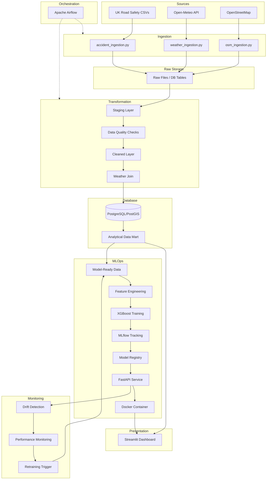
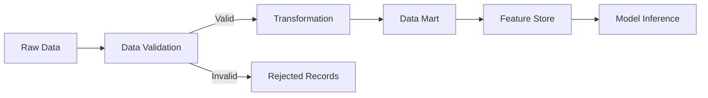
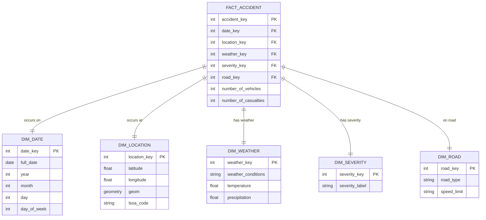

# Architecture Overview

## Overview
This document outlines the architecture for the Traffic Accident Severity Analytics and Prediction project. The architecture is designed to handle the end-to-end lifecycle of data, from ingestion to model serving and monitoring.

## Complete Architecture Diagram

## Data Flow Diagram

## Database Schema Diagram

## Technology Stack
| Component | Technology |
|-----------|------------|
| Backend | Python 3.11+ |
| Database | PostgreSQL 16+, PostGIS 3.4+ |
| Orchestration | Apache Airflow |
| Visualization | Streamlit, Plotly, Folium |
| ML Framework | XGBoost, scikit-learn |
| MLOps | MLflow, FastAPI, Docker |

## Layer Descriptions
- **Source:** External datasets (CSVs, APIs).
- **Ingestion:** Python scripts fetching data.
- **Raw:** Untouched data as it arrives.
- **Staging:** Initial loading zone, basic type casting.
- **Cleaned:** Data post-validation and standardization.
- **Analytical:** Star schema optimized for querying.
- **Model-Ready:** Flattened data with engineered features for ML.

## MLOps Architecture
The MLOps pipeline encompasses model training using XGBoost, experiment tracking and model versioning via MLflow, and serving through a containerized FastAPI application. It includes automated pipelines for feature engineering and retraining.

## Monitoring Architecture
Monitoring tracks data drift (e.g., Population Stability Index for feature distributions) and model performance (e.g., Recall, False Negatives). Metrics are logged to the database, and alerts trigger automated retraining when thresholds are breached.
