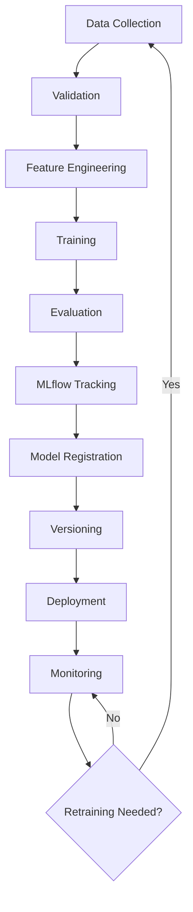

# MLOps Pipeline Documentation

## Model Selection
XGBoost was selected for the severity classification task due to its robust handling of tabular data, built-in capabilities for dealing with missing values, and its efficiency in modeling non-linear relationships. It generally outperforms standard Logistic Regression or Random Forests on this dataset format.

## Class Imbalance
The target variable (`accident_severity`) is heavily imbalanced:
- Slight: ~82%
- Serious: ~15%
- Fatal: ~3%
To address this, we use `sample_weight` during XGBoost training, calculated using `sklearn.utils.class_weight.compute_sample_weight('balanced')`. This penalizes the model more for misclassifying minority classes (Fatal/Serious), improving Recall for severe accidents.

## Data Split
The dataset is split chronologically into Train (70%), Validation (15%), and Test (15%). A temporal split is critical to prevent data leakage and simulate real-world scenarios where we predict future accident severities based on past data.

## Feature Engineering
Features are categorized into groups:
- **Temporal:** hour_of_day, day_of_week, month, is_weekend, is_rush_hour
- **Spatial/Location:** latitude, longitude, urban_or_rural_area
- **Weather:** temperature, precipitation, weather_conditions_encoded
- **Road:** speed_limit, road_type_encoded, light_conditions_encoded
- **Accident Context:** number_of_vehicles, number_of_casualties

## Model Training
The model is trained using `xgboost.XGBClassifier`. Hyperparameters are tuned (e.g., `max_depth`, `learning_rate`, `n_estimators`), and early stopping is employed using the validation set to prevent overfitting.

## Evaluation Metrics
Since misclassifying a severe accident as slight is dangerous, **Recall** for Fatal and Serious classes is prioritized over overall Accuracy. **Macro-F1** is used as a balanced metric. We evaluate using a Confusion Matrix and log per-class metrics.

## MLflow Integration
MLflow tracks all experiments. 
- Parameters logged: model config, feature list.
- Metrics logged: train/val loss, Recall, Precision, Macro-F1.
- Artifacts: Trained model, confusion matrix plot, feature importance plot.

## Model Registry
Models are registered in MLflow's Model Registry. The lifecycle stages are `None` → `Staging` (for testing) → `Production` (served by FastAPI) → `Archived`.

## Inference Pipeline
A single scikit-learn pipeline object encapsulates both preprocessing steps (scaling, encoding) and the XGBoost model. This ensures consistency between training and serving, preventing training-serving skew.

## Model Lifecycle

## Monitoring
The system monitors production traffic:
- **Data Drift:** Input feature distributions compared to training data (using Population Stability Index - PSI).
- **Performance:** If ground truth becomes available, logs latency, failures, and false-negative rates.

## Retraining Criteria
The automated retraining pipeline is triggered if any of these configurable thresholds are met:
- Macro-F1 < 0.60
- Recall (Fatal/Serious) < 0.50
- False-negative rate > 15%
- Feature drift PSI > 0.20
- Class distribution shift > 10%
- 10,000+ new labeled records available

## Deployment
The model is served using FastAPI, which provides a RESTful `/predict` endpoint. The entire application (FastAPI, MLflow server) is containerized using Docker and orchestrated via `docker-compose.yml`.
